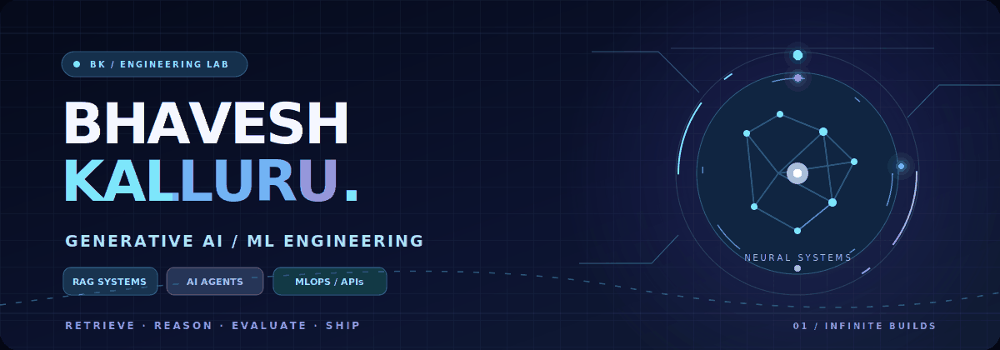
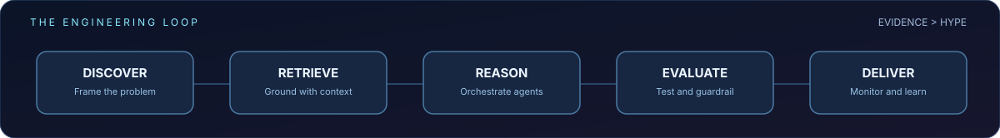
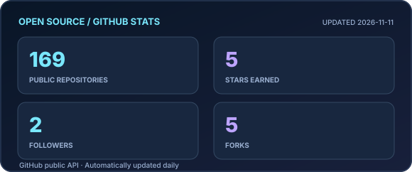
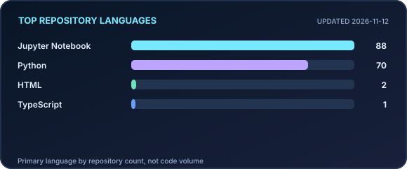
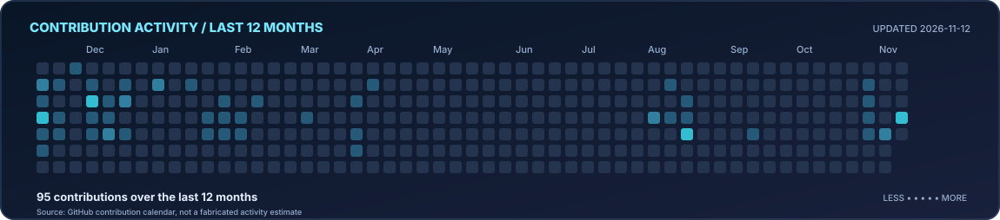

<!-- NEURAL NIGHT EDITION · Designed for GitHub profile rendering -->

  

  

  

 
BUILD WITH PURPOSE &nbsp; · &nbsp; GROUND WITH EVIDENCE &nbsp; · &nbsp; SHIP WITH CONFIDENCE

---

## ◈ The engineer behind the systems

<table><tr><td width="58%" valign="top">

### Hello, I'm Bhavesh 👋

I'm a **Generative AI and Machine Learning Engineer** with **6+ years of experience** across ML applications, enterprise AI workflows and data-driven systems.

I focus on the space between a polished prototype and a useful production system: **retrieval quality, agent coordination, evaluation, APIs, observability and deployment**.

- 🧠 **Designing:** grounded LLM applications and multi-agent workflows
- ⚙️ **Engineering:** Python services, inference pipelines and MLOps
- 🔎 **Optimizing:** retrieval relevance, performance and reliability
- 🎯 **Exploring:** full-time GenAI / ML engineering opportunities in the U.S.

</td><td width="42%" valign="top">

### `> whoami`

**Name:** Bhavesh Kalluru

**Focus:** RAG · Agentic AI · ML Engineering

**Build style:** end-to-end

**Philosophy:** *Evidence > hype*

**Learning:** MCP · AI evaluation · responsible AI

</td></tr></table>

## ✧ How I build intelligent systems

> **My north star:** an AI system should be not just clever, but explainable, testable, resilient and valuable to the people using it.

---

## ⚡ Featured engineering projects

<table>
<tr>
<td width="50%" valign="top">

### 🛡️ [AI Incident Command Center](https://github.com/bhavesh-kalluru/Ai-Incident-Command-Center)

**Operational AI · Observability**

Simulated real-time service telemetry, explainable anomaly rules, alert acknowledgment and optional AI-assisted incident summaries.

**Stack:** Python · Streamlit · SQLite · Docker

[Explore source →](https://github.com/bhavesh-kalluru/Ai-Incident-Command-Center)

</td>
<td width="50%" valign="top">

### 🔍 [GenAI Playbook](https://github.com/bhavesh-kalluru/GenAI-Playbook)

**Retrieval-Augmented Generation**

A hands-on RAG environment featuring document ingestion, chunking, embeddings, ChromaDB retrieval and citation-backed responses.

**Stack:** OpenAI · Python · ChromaDB · Streamlit

[Explore source →](https://github.com/bhavesh-kalluru/GenAI-Playbook)

</td>
</tr>
<tr>
<td width="50%" valign="top">

### 🧾 [AI Returns & Claims Hub](https://github.com/bhavesh-kalluru/AI-Returns-Claims-Hub-End-to-End-ML-NLP-CV-GenAI-Web-App)

**ML · NLP · Computer Vision**

An end-to-end demo combining claims data, text classification, image-quality checks, refund prediction and GenAI support workflows.

**Stack:** scikit-learn · NLP · Streamlit · SQL

[Explore source →](https://github.com/bhavesh-kalluru/AI-Returns-Claims-Hub-End-to-End-ML-NLP-CV-GenAI-Web-App)

</td>
<td width="50%" valign="top">

### 🌐 [AI Trends RAG](https://github.com/bhavesh-kalluru/AI_Trends_RAG)

**Live retrieval · Industry intelligence**

A search-assisted RAG app for exploring AI news, emerging tools and research themes with summarized findings.

**Stack:** RAG · Tavily · OpenAI · Streamlit

[Explore source →](https://github.com/bhavesh-kalluru/AI_Trends_RAG)

</td>
</tr>
</table>

---

## 🧰 My engineering toolkit

<b>Languages · Frameworks · Platforms</b>  

| Specialty | Tools and approaches |
|:--|:--|
| **GenAI & agents** | LangChain · LangGraph · LlamaIndex · OpenAI · Hugging Face · Transformers |
| **Retrieval & search** | RAG · FAISS · Vector embeddings · Hybrid retrieval · Elasticsearch · Re-ranking |
| **Machine learning** | PyTorch · TensorFlow · scikit-learn · JAX · Evaluation · Fine-tuning |
| **Serving & MLOps** | FastAPI · Streamlit · Docker · MLflow · ONNX · CI/CD |
| **Data & analytics** | SQL · PostgreSQL · MySQL · SQLite · Snowflake · dbt · Pandas |

---

## 📡 Live GitHub telemetry

  
   Premium self-hosted SVG dashboards generated from GitHub data every day — no fragile third-party stats servers.

### 📊 GitHub statistics · Most common repository languages

  
  

Language distribution counts repositories by their primary language, not total lines of code or professional proficiency.

### 📈 GitHub contribution activity graph

  
   Built from GitHub's contribution calendar. Refreshed daily by <a href="https://github.com/bhavesh-kalluru/bhavesh-kalluru/actions/workflows/telemetry.yml">GitHub Actions</a>.

### 🐍 Watch my contributions come alive

  
   Animated by <a href="https://github.com/bhavesh-kalluru/snk">snk</a> — keep coding, keep growing.

  
  

---

## 🧪 What I'm exploring now

| 🧠 Agent engineering | 🧯 Trustworthy AI |
|:--|:--|
| Multi-agent orchestration, tool use, Model Context Protocol | Evaluations, factual grounding, safety, governance |

| 📦 Production ML | 🌐 Portfolio engineering |
|:--|:--|
| Model optimization, monitoring and deployment | Full-stack builds across industry sectors |

<b>⚡ Beyond the code</b>
 
I'm into new technology, trucking and volleyball — and always interested in how complex systems work.

---

## 🐾 Play Mode · Fetch Break

  Even AI engineers need a little playtime. 🎾
   
  
   
  Catch. Celebrate. Back to building. 🐶

---

## ✨ Daily signals

<b>📖 Today's word · 🧠 Today's tech term · 💬 Today's quote</b>
 

**Word of the day**

<!-- DAILY:WORD -->
**Ebullience** — Cheerful, energetic enthusiasm
<!-- END:WORD -->

**Tech term of the day**

<!-- DAILY:TECH -->
**RAG** — Retrieval-Augmented Generation
<!-- END:TECH -->

**Quote of the day**

<!-- DAILY:QUOTE -->
> “Make it work, make it right, make it fast.” — Kent Beck
<!-- END:QUOTE -->

---

### Have a challenging AI problem worth solving?

**Let's turn it into something reliable, useful and real.**

  Designed around the work — not just the widgets. ⚡

