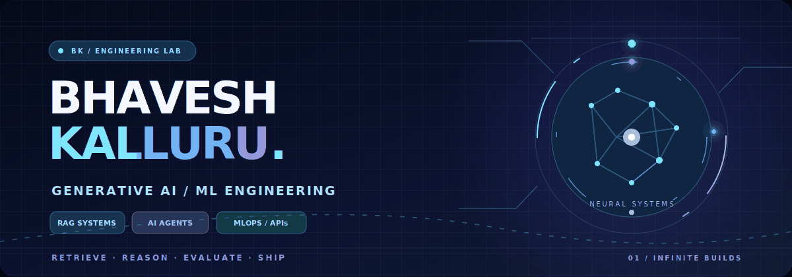
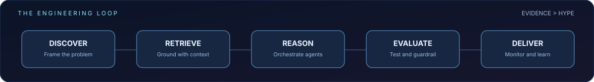
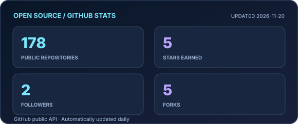
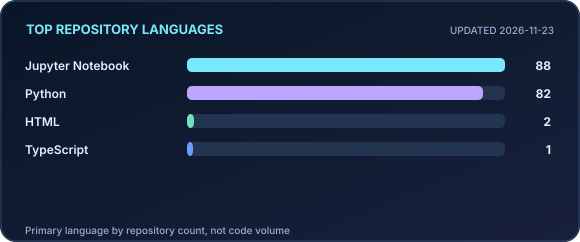
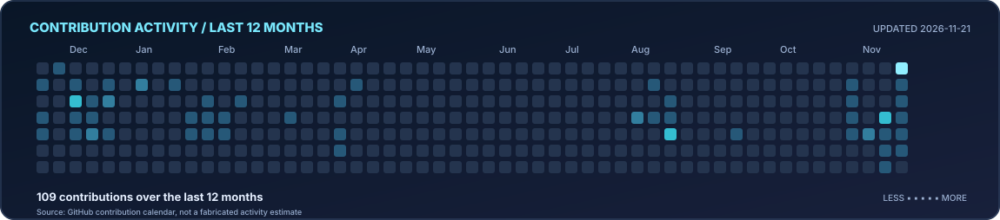

<!-- NEURAL NIGHT EDITION · Designed for GitHub profile rendering -->

  

  

  

 
BUILD WITH PURPOSE &nbsp; · &nbsp; GROUND WITH EVIDENCE &nbsp; · &nbsp; SHIP WITH CONFIDENCE

---

## ◈ The engineer behind the systems

<table><tr><td width="58%" valign="top">

### Hello, I'm Bhavesh 👋

I'm a **Generative AI and Machine Learning Engineer** focused on ML applications, enterprise AI workflows and data-driven systems.

I focus on the space between a polished prototype and a useful production system: **retrieval quality, agent coordination, evaluation, APIs, observability and deployment**.

- 🧠 **Designing:** grounded LLM applications and multi-agent workflows
- ⚙️ **Engineering:** Python services, inference pipelines and MLOps
- 🔎 **Optimizing:** retrieval relevance, performance and reliability
- 🎯 **Exploring:** full-time GenAI / ML engineering opportunities in the U.S.

</td><td width="42%" valign="top">

### `> whoami`

**Name:** Bhavesh Kalluru

**Focus:** RAG · Agentic AI · ML Engineering

**Build style:** end-to-end

**Philosophy:** *Evidence > hype*

**Learning:** MCP · AI evaluation · responsible AI

</td></tr></table>

## ✧ How I build intelligent systems

> **My north star:** an AI system should be not just clever, but explainable, testable, resilient and valuable to the people using it.

---

## ⚡ Featured engineering projects

**Engineering Beyond Tutorials.** I organize my portfolio around practical problems, architecture choices, testable workflows, and documented trade-offs. Each project below links to its own repository. I distinguish prototypes and simulated data from production deployments.

<table>
<tr>
<td width="50%" valign="top">

### 🛡️ [AI Incident Command Center](https://github.com/bhavesh-kalluru/Ai-Incident-Command-Center)

**Operational AI · Observability**

Simulated real-time service telemetry, explainable anomaly rules, alert acknowledgment and optional AI-assisted incident summaries.

**Stack:** Python · Streamlit · SQLite · Docker

[Explore source →](https://github.com/bhavesh-kalluru/Ai-Incident-Command-Center)

</td>
<td width="50%" valign="top">

### 🔍 [GenAI Playbook](https://github.com/bhavesh-kalluru/GenAI-Playbook)

**Retrieval-Augmented Generation**

A hands-on RAG environment featuring document ingestion, chunking, embeddings, ChromaDB retrieval and citation-backed responses.

**Stack:** OpenAI · Python · ChromaDB · Streamlit

[Explore source →](https://github.com/bhavesh-kalluru/GenAI-Playbook)

</td>
</tr>
<tr>
<td width="50%" valign="top">

### 🧾 [AI Returns & Claims Hub](https://github.com/bhavesh-kalluru/AI-Returns-Claims-Hub-End-to-End-ML-NLP-CV-GenAI-Web-App)

**ML · NLP · Computer Vision**

An end-to-end demo combining claims data, text classification, image-quality checks, refund prediction and GenAI support workflows.

**Stack:** scikit-learn · NLP · Streamlit · SQL

[Explore source →](https://github.com/bhavesh-kalluru/AI-Returns-Claims-Hub-End-to-End-ML-NLP-CV-GenAI-Web-App)

</td>
<td width="50%" valign="top">

### 🌐 [AI Trends RAG](https://github.com/bhavesh-kalluru/AI_Trends_RAG)

**Live retrieval · Industry intelligence**

A search-assisted RAG app for exploring AI news, emerging tools and research themes with summarized findings.

**Stack:** RAG · Tavily · OpenAI · Streamlit

[Explore source →](https://github.com/bhavesh-kalluru/AI_Trends_RAG)

</td>
</tr>
</table>

---

## 🧭 Engineering Decision Journal

The code shows *what* I built; the decision journal explains *why* I built it that way.

| Lens | What I document |
|:--|:--|
| **Problem & constraints** | Users, business workflow, assumptions, and what is simulated |
| **Architecture** | System boundaries, API design, persistence, and deployment model |
| **Trade-offs** | Alternatives considered, chosen approach, and limitations |
| **Verification** | Reproducible tests, CI results, screenshots, and demo evidence |
| **Next iteration** | Reliability, security, usability, and scaling improvements |

**Featured case-study directions:** incident response and observability, retrieval quality and citations, and multi-modal claims triage. I will add measured outcomes and demos only when they are verified in the individual repositories.

### Industry Engineering Lab

I also explore full-stack systems across sectors such as municipal utilities, retail sustainability, and library operations. **Work-in-progress projects are not presented as published repositories.** Each completed project will have a separate public repository, a demo, an architecture overview, and an explicit verification checklist.

**Project quality bar:** clear README · setup instructions · sample data · validation · tests · CI · Docker/deployment guide · limitations

**Lab notebook · 2026-11-27 (not published):** LoomLine — Textile Roll Inspection Ledger (textile manufacturing). Browser dashboard, standard-library Python JSON API, SQLite, synthetic rolls, Docker and CI configuration. **Decision:** normalized unique roll codes prevent duplicate inserts; length-weighted affected percentages avoid averaging unequal rolls. Integer meters simplify validation but omit fractional lengths; no correction workflow. **Verified:** six local unittest tests passed, including HTTP read/write, validation, duplicate rejection, persistence and idempotent seed; ZIP integrity passed. **Unverified:** interactive browser, Docker, hosted CI and deployment. No authentication or quality certification. Repository creation capability unavailable; no project link.

**Lab notebook · 2026-11-26 (not published):** ReclaimGrid — Construction Material Reuse Exchange (circular construction). Browser UI, standard-library Python JSON API, SQLite stock and allocation ledger, synthetic seed data, Docker and CI configuration. **Decision:** conditional stock decrement and ledger insert share a serialized transaction; no distributed scaling or retry idempotency. **Verified:** seven local unittest tests passed, including competing allocations; seed command and ZIP integrity passed. **Unverified:** browser interaction, Docker, hosted CI and deployment. No authentication or material safety certification. Repository creation capability unavailable; no project link.

**Lab notebook · 2026-11-25 (not published):** SproutTrace — Greenhouse Batch Tracker (commercial horticulture). Browser stage board, standard-library Python HTTP/JSON API, SQLite, synthetic batches, Docker and CI configuration. **Decision:** transactional stage updates plus optimistic versions reject stale requests; zero third-party dependencies simplify local setup at the cost of production HTTP features. **Verified:** nine local unittest tests passed, including HTTP retrieval, validation, persistence, seed and lifecycle; ZIP integrity passed. **Unverified:** browser interaction, Docker, hosted CI and deployment. No authentication, audit history or real greenhouse integration. Dedicated repository creation unavailable; no project link.

**Lab notebook · 2026-11-24 (not published):** PressLedger — Print Shop Job Tracker (commercial printing). Browser dashboard, Flask JSON API, SQLite persistence, fictional orders, validated production increments, Docker and CI configuration. **Decision:** `BEGIN IMMEDIATE` serializes quantity checks and updates; no authentication, audit history or retry idempotency. **Verification:** Python syntax compilation and ZIP integrity passed; pytest collection blocked by missing Flask and network dependency installation failure. Docker, CI and browser interaction unverified. Dedicated repository creation unavailable; no project link.

**Lab notebook · 2026-11-17 (not yet published):** GatherSpace — Community Venue Booking (community events and venue operations). A distinct FastAPI + SQLite + browser UI portfolio project, with validated timezone-aware bookings, capacity checks, serialized conflict detection, soft cancellation, sample data, Docker and CI configuration. **Verified locally:** 8 pytest tests passed with no warnings; seed script created 3 venues and 2 sample bookings; ZIP integrity checked. **Not verified:** Docker build, GitHub Actions, hosted demo. **Decision:** SQLite `BEGIN IMMEDIATE` makes the overlap check and insert atomic for a single SQLite database, but it is not a scalable multi-node booking service. The dedicated public repository has not been created; no project link is included.

**Lab notebook · 2026-11-16 (not yet published):** ArchiveCare — Museum Conservation Workbench (cultural heritage) is packaged locally as a distinct FastAPI + SQLite + browser-UI project with validated artifact intake, priority queues, state transitions, and event history. **Verified:** 6 local pytest tests passed; synthetic seed script ran. **Unverified:** Docker build and GitHub Actions execution. **Trade-offs:** a lightweight state machine and SQLite support a reproducible demonstration but lack authentication, concurrent write coordination, and institutional collections standards. A dedicated public repository has not been created; no project link is shown.\n\n**Published lab project · 2026-11-15:** [YardFlow — Rail Yard Slot Planner](https://github.com/bhavesh-kalluru/rail-yard-slot-planner-2026-11-15) (freight logistics) — a synthetic full-stack scheduling demo using FastAPI, SQLite, a browser UI, Docker, and GitHub Actions CI configuration. **Local verification:** 4 tests passed (2 FastAPI deprecation warnings). **CI status:** workflow published; successful GitHub Actions run not yet verified. **Trade-offs:** SQLite and interval checks keep the demo simple but do not protect against concurrent booking races; not suitable for safety-critical railway dispatch. No live demo or screenshots published.

---

## 🧰 My engineering toolkit

<b>Languages · Frameworks · Platforms</b>  

| Specialty | Tools and approaches |
|:--|:--|
| **GenAI & agents** | LangChain · LangGraph · LlamaIndex · OpenAI · Hugging Face · Transformers |
| **Retrieval & search** | RAG · FAISS · Vector embeddings · Hybrid retrieval · Elasticsearch · Re-ranking |
| **Machine learning** | PyTorch · TensorFlow · scikit-learn · JAX · Evaluation · Fine-tuning |
| **Serving & MLOps** | FastAPI · Streamlit · Docker · MLflow · ONNX · CI/CD |
| **Data & analytics** | SQL · PostgreSQL · MySQL · SQLite · Snowflake · dbt · Pandas |

---

## 📡 Live GitHub telemetry

  
   Premium self-hosted SVG dashboards generated from GitHub data every day — no fragile third-party stats servers.

### 📊 GitHub statistics · Most common repository languages

  
  

Language distribution counts repositories by their primary language, not total lines of code or professional proficiency.

### 📈 GitHub contribution activity graph

  
   Built from GitHub's contribution calendar. Refreshed daily by <a href="https://github.com/bhavesh-kalluru/bhavesh-kalluru/actions/workflows/telemetry.yml">GitHub Actions</a>.

### 🐍 Watch my contributions come alive

  
   Animated by <a href="https://github.com/bhavesh-kalluru/snk">snk</a> — keep coding, keep growing.

  
  

---

## 🧪 What I'm exploring now

| 🧠 Agent engineering | 🧯 Trustworthy AI |
|:--|:--|
| Multi-agent orchestration, tool use, Model Context Protocol | Evaluations, factual grounding, safety, governance |

| 📦 Production ML | 🌐 Portfolio engineering |
|:--|:--|
| Model optimization, monitoring and deployment | Full-stack builds across industry sectors |

<b>⚡ Beyond the code</b>
 
I'm into new technology, trucking and volleyball — and always interested in how complex systems work.

---

## 🐾 Play Mode · Fetch Break

  Even AI engineers need a little playtime. 🎾
   
  
   
  Catch. Celebrate. Back to building. 🐶

---

## ✨ Daily signals

<b>📖 Today's word · 🧠 Today's tech term · 💬 Today's quote</b>
 

**Word of the day**

<!-- DAILY:WORD -->
**Serendipity** — Finding something good without looking for it
<!-- END:WORD -->

**Tech term of the day**

<!-- DAILY:TECH -->
**PEFT** — Parameter-Efficient Fine-Tuning
<!-- END:TECH -->

**Quote of the day**

<!-- DAILY:QUOTE -->
> “Whether you think you can or you can’t, you’re right.” — Henry Ford
<!-- END:QUOTE -->

---

### Have a challenging AI problem worth solving?

**Let's turn it into something reliable, useful and real.**

  Designed around the work — not just the widgets. ⚡

